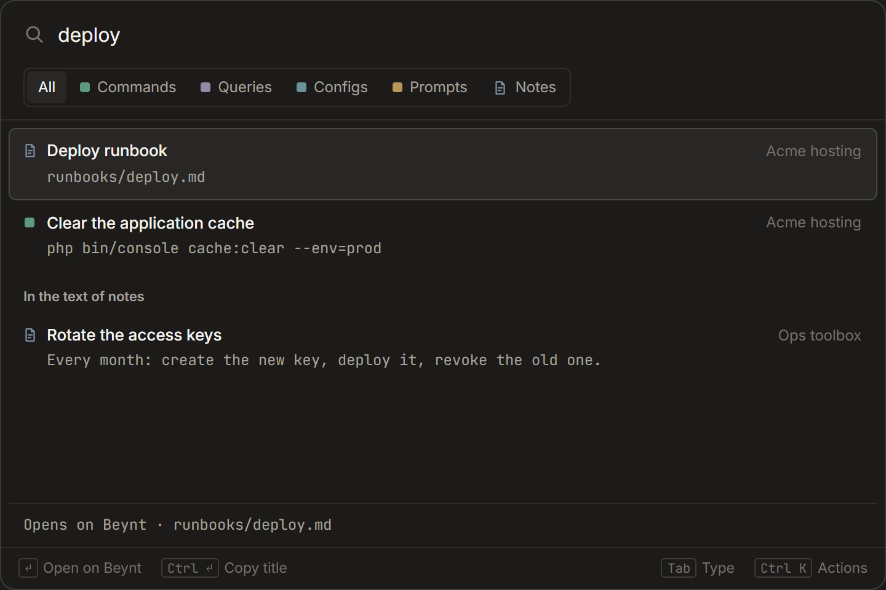
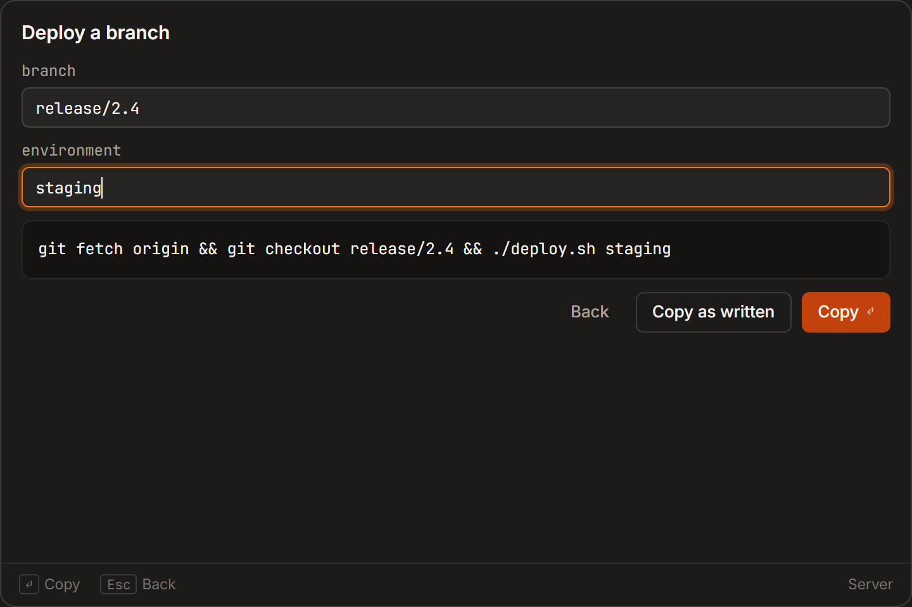
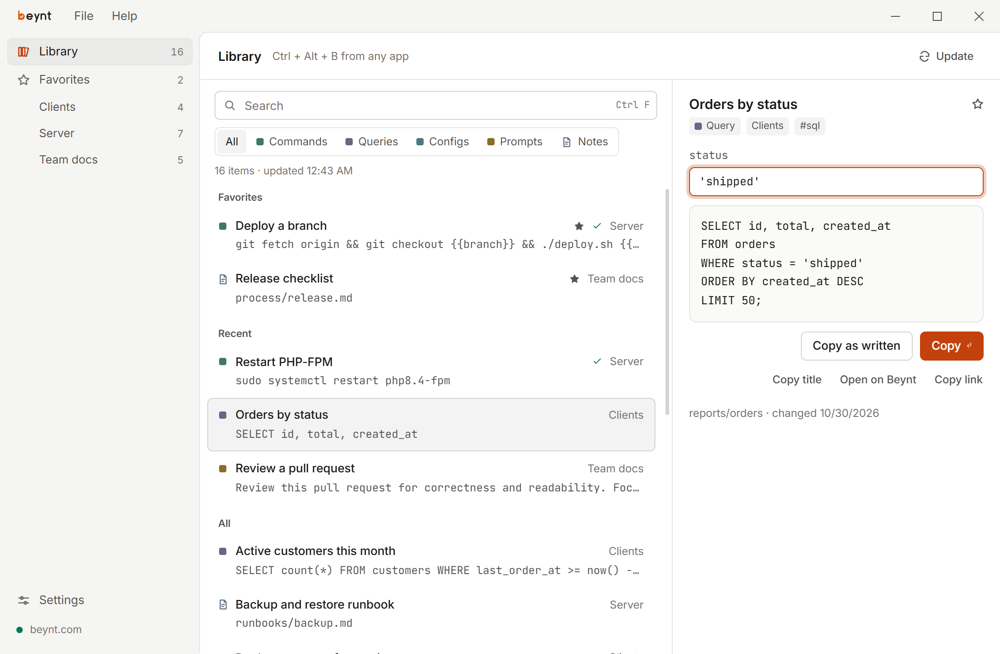

# Beynt desktop

The desktop companion of [Beynt](https://beynt.com): your commands and notes at hand in any app.
For Windows, macOS and Linux.



- **Search from any app** — press **Ctrl + Alt + B** (**⌥⇧Space** on a Mac, changeable in Settings),
  type a few words, press Enter. A command, query, config or prompt asks for its `{{placeholders}}`
  and lands on the clipboard; a note opens in beynt.com's reader. Before you type, the search shows
  your favorites and what you use most lately.
- **Narrow it down** — **Tab** picks a type (commands, queries, configs, prompts, notes), `#tag` keeps
  what has that tag, and a stack's name keeps that stack. A word typed with one letter wrong, missing
  or swapped still finds what you meant.



- **Actions** — **Ctrl + Enter** (⌘↵) copies a note's title, ready to name it to an AI agent that
  reads Beynt, or copies a command as written; **Ctrl + K** (⌘K) lists every action of the selected
  item: copy the title or the link, open it on Beynt, add it to the favorites.
- **Text of notes** — after a short pause in typing, the words are also searched in the text of
  your notes through Beynt's own search, with the line where they appear.
- **Library** — every command, query, config, prompt and note of the stacks your access key can
  reach, filtered by stack and type, a stack grouped by its folders. Beynt stays the only source: the
  app keeps a local copy for instant search and offline use, updates it every 10 minutes while it
  runs, downloads only what changed, and never keeps a note's text.
- **Account** — the first window asks for an access key: it opens the page on Beynt where you create
  one (*Find work only*, that is `stacks:read` and `artifacts:read`). The key is kept in the system
  keychain, and the app only reads.



Beynt starts at login in the tray (Settings → Start-up), so the shortcut works right away; closing the
window keeps it running in the tray or the Mac's menu bar, and the tray menu (⌘Q on a Mac) quits. On
Windows 11 the search window uses the system Acrylic material. The theme follows the system unless you
pick dark or light.

## Install

The installers are on the [Releases](../../releases) page, each with its SHA-256. They are not signed yet:

- **Windows** — `Beynt-<version>-win-x64.exe`. SmartScreen says "Windows protected your PC":
  choose *More info → Run anyway*.
- **macOS** (Apple silicon and Intel) — `Beynt-<version>-mac-universal.dmg`. Drag Beynt to
  Applications. The first time macOS refuses to open it: *System Settings → Privacy & Security →
  Open Anyway*.
- **Linux** — on Debian and Ubuntu the `.deb` (`sudo apt install ./Beynt-<version>-linux-amd64.deb`),
  elsewhere the AppImage (`chmod +x`). The key is kept by the Secret Service (GNOME Keyring, KWallet):
  without one the app does not save it. Wayland desktops may not allow the app's global shortcut:
  Settings then shows the command to bind to a shortcut in your system settings (`beynt-desktop --palette`,
  or the AppImage path with `--palette`). On GNOME the tray icon needs the AppIndicator extension.

**Updates** — from 0.7.0 the app looks for a new version at start and every few hours. When there is
one, the sidebar says so; *Install* downloads it from this repository's releases, installs it only if
it is signed with the project's key, and starts the new version. On Linux the AppImage and the `.deb`
update the same way (the `.deb` asks for the administrator password). Versions before 0.7.0 update by
installing over them once.

Windows is where the app is used every day; the macOS and Linux builds come from CI and still need
trying on real machines. Reports are welcome.

## Develop

Requires Node.js **22.12+** and Rust (stable), plus on Linux the
[Tauri prerequisites](https://v2.tauri.app/start/prerequisites/).

```sh
npm ci
npm run dev            # Vite on :5173 with HMR, and the app with its own development profile
```

Development uses a separate identifier (`com.beynt.desktop.dev`: its own key, data and single
instance) and shows **DEV** in the title bar.

## Build & package

```sh
npm run build          # typecheck + the page into dist/
npm run dist           # the installer of this system, under src-tauri/target/release/bundle/
```

Each installer is built on its own system. Pushing a tag `v<version>` that matches `package.json`
runs the release workflow: it builds the installers on GitHub Actions, signs the update files with
the project's key (kept in the repository's secrets), and attaches everything to a draft release with
the SHA-256 of each installer and `latest.json`, where installed apps look for a new version.
Publishing the draft is a manual step, and the one that makes the update reach installed apps.
A local `npm run dist` makes unsigned installers; nothing in the app depends on the private key.

## Verify

```sh
npm test               # Vitest, then cargo test (including the sync against a fake Beynt API)
npx tsc --noEmit       # typecheck
```

CI builds and tests on Windows and Linux at every push, with clippy and rustfmt; the release workflow
also builds and tests on macOS. See [CONTRIBUTING.md](CONTRIBUTING.md).

## Architecture

The **Rust side** (`src-tauri/`, Tauri 2) owns everything privileged: the access key (`account.rs`),
Beynt's REST API (`api.rs`), the local library (`library.rs`), the palette window and its global
shortcut (`palette.rs`), the tray and the Mac menu bar (`menu.rs`), start at login (`startup.rs`)
and updates (`update.rs`).
The **page** (`src/`, React) is UI only and asks the Rust side through typed commands (`src/api.ts`);
the same page renders the main window and, at `#palette`, the palette.

## Security

For private vulnerability reporting and safe contributions, see [SECURITY.md](SECURITY.md).

- The access key is kept in the system keychain, only by the Rust side, and sent only to the Beynt
  address it was checked against; it never reaches the page.
- Notes open in the browser, and copied links point, only to that same address. The words typed in
  the search go to that Beynt too, to search the text of notes.
- The page makes no network calls and runs under a strict Content-Security-Policy, with no inline
  scripts or styles; it can navigate nowhere outside the app and open no window.
- Installed builds always verify TLS, with the system's certificates and proxy settings.
- Besides that Beynt address, the app contacts only this repository's releases on github.com, to
  look for updates. An update installs only when you choose *Install*, and only if its signature
  matches the public key in `src-tauri/tauri.conf.json`: a file changed on the way, or published
  without the project's private key, is refused.

## License

[MIT](LICENSE) © 2026 Lucio
